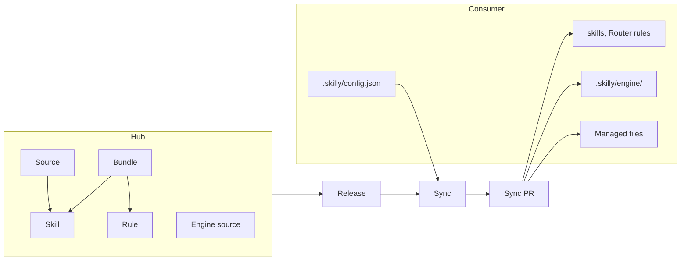

# Skilly

Private skill hub: Bundle definitions, the Engine, and a nightly sync that keeps skills, checks and CI the same in every Consumer. Why: [ADR-0008](docs/adr/0008-hub-run-sync-and-pinned-engine.md).

## Language

**Hub**:
This repo, `timschoch/skilly`, private. Holds Bundle definitions, the Engine source and the nightly sync. Ships skills of its own. Runs `main` itself, so it is the first Consumer of every change.
_Avoid_: Registry, launcher

**Release**:
A git tag of the Hub, for example `v1.4.0`, made when the Release PR from release-please merges. A Consumer runs one Release, named in `.skilly/config.json` as `"hub"`. A new major version never auto-merges.
_Avoid_: Version (alone), SHA

**Release snapshot**:
A folder with the files of one Release: Bundle configs, Router rules, the Engine, Managed file templates. The Sync reads it as its input. The nightly checks out the tag, a local command fetches it, a test uses a fixture folder.
_Avoid_: bundle dir, checkout

**Engine**:
All skilly code that hooks, CI or the CLI run: sync, setup, verify, checks, and the templates of the Managed files. Copied into each Consumer at `.skilly/engine/` by the Sync PR. A hand edit stops the nightly sync for that Consumer.
_Avoid_: Tool (that's a tier), runtime, kit

**Managed file**:
A file in a Consumer that the Sync PR writes from the Engine and a person does not edit: `.github/workflows/ci.yml`, `nightly.yml`. In hook files such as `lefthook.yml`, the Sync PR owns only the skilly entries.
_Avoid_: Template, caller

**skilly App**:
The one GitHub App the Hub uses to sync Consumers. Installed once per account with "All repositories". The Hub syncs only accounts on its owner allowlist.
_Avoid_: Bot, token

**Skill**:
A directory with a `SKILL.md`, installable by the skills CLI. Lives in its source repo, not (usually) in the hub.

**Source**:
A repo that holds skills — the user's own or third-party. The hub points at sources; it does not own them.
_Avoid_: Upstream, origin

**Bundle**:
A named, categorized group of skills across sources, defined as config data in the hub. Drives install and removal only — never update.
_Avoid_: Preset, collection, group

**Consumer**:
A repo with `.skilly/config.json` on an account where the skilly App is installed. The Hub's nightly syncs it.
_Avoid_: Client, target repo

**Default branch**:
The branch GitHub names default in a Consumer. Read, never assumed to be `main`. The Engine resolves it.
_Avoid_: master

**Self-source**:
A consumer that is also a source of skills its own bundles name. Identified by the git remote, never the directory name. Bundle resolution drops a skill from its own source when the repo already holds it in `.agents/skills/` without a pin: it is never pinned back into the repo that writes it. A skill kept anywhere else, like the hub's `bundles/`, still installs.
_Avoid_: Self-hosting, local source

**Pin**:
One entry in a consumer's `skills-lock.json`, recording a skill and its real source. Owned by the skills CLI, not by skilly.

**Add**:
Adding a skill or Bundle to a Consumer now, on the current branch: `node .skilly/engine/bin/skilly.js add <name>`. Edits `.skilly/config.json`, then runs the Sync locally.
_Avoid_: install, setup

**Remove**:
Removing a skill or Bundle from a Consumer, the same way as Add.
_Avoid_: delete

**Sync**:
The Engine code that makes a Consumer match its `.skilly/config.json` at a Release: skills, Router rules, Engine, Managed files. The Hub's nightly runs it for every Consumer. `skilly sync` runs the same Sync and Sync PR for one Consumer, with the person's `gh` login. Add and Remove run it locally.
_Avoid_: update, upgrade

**Sync report**:
The one record of what a Sync changed: skills added and removed, Release before and after, Managed files written. The Sync PR body, the auto-merge choice and the edited-Engine issue read it.
_Avoid_: summary, log

**Setup**:
The manual, local command that makes a repo a Consumer: `npx github:timschoch/skilly#<release> setup`. Two phases: decide, then apply. In the decide phase an agent asks, and its scripts write `.skilly/config.json`. The apply phase asks nothing: it runs the first Sync and sets the repo settings. Safe to run again. [ADR-0009](docs/adr/0009-setup-decides-then-applies.md).
_Avoid_: install, config, onboard

**Sync PR**:
The pull request the Hub's nightly opens in a Consumer. It moves skills, Engine and Managed files to the newest Release in one step. GitHub auto-merges it when `ci / verify` is green, unless it removes a skill or is a new major version.

**Upstream**:
The repo a fork follows, for example `twentyhq/twenty` for `admin-laicadev/twenty`. Not a Source: the Hub does not read skills from it.

**Upstream PR**:
The one standing PR in a fork that [check-upstream.yml](.github/workflows/check-upstream.yml) keeps on the newest Upstream release. Merge = upgrade, close = skip its releases.

**Dependent**:
A repo that runs a fork, for example `admin-laicadev/laica-stack` for the Twenty fork. The Upstream PR agent reads it to judge what a release changes for us.
_Avoid_: Consumer (that's a repo the Hub syncs skills into)

**Rule**:
A named workflow requirement attached to a Bundle, for example conventional commits. The Bundle adds it as a verify step, so a Consumer enforces the union of its Bundles' Rules in `ci / verify`.
_Avoid_: Check, policy, gate

**Router rule**:
An always-loaded line that tells the agent "when <trigger> → read <skill file> in full and apply it". Ships skills the agent may not invoke (`disable-model-invocation`) without forking them. Ships with its skill, named `{skill-name}-{rule-name}`; installed and removed wholesale by the rules script, never diffed.
_Avoid_: Rule (that's the PR-gate concept), principle
