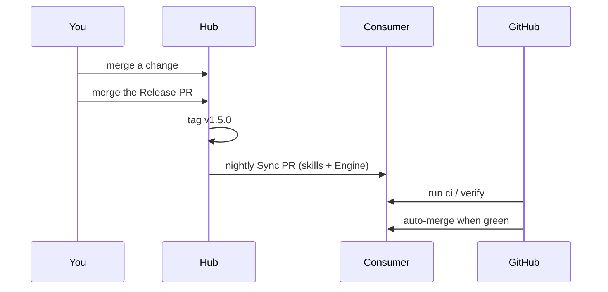

# skilly

Private skill hub for one person and their agents. It keeps skills, checks and CI the same in every Consumer repo. Why it works this way: [ADR-0008](docs/adr/0008-hub-run-sync-and-pinned-engine.md). Bundle catalog: [docs/bundles.md](docs/bundles.md). Checks per tier: [docs/dev-process.md](docs/dev-process.md).

## How it works

A Consumer gets two things from the Hub, both at one Release:

| What                                                | Lands in                            | Used by            |
| --------------------------------------------------- | ----------------------------------- | ------------------ |
| Knowledge: skills and Router rules                  | `.agents/skills/`, `.claude/rules/` | agents             |
| Engine: the code for sync, setup, verify and checks | `.skilly/engine/`                   | hooks, CI, the CLI |

`.skilly/config.json` names the Bundles, the tier and the Release (`"hub": "v1.4.0"`). Each night the Hub moves every Consumer to the newest Release with one Sync PR:



The Sync PR waits for you when it removes a skill or the Release is a new major version.

## Set up an account, once

1. Install the skilly App on the account, with "All repositories".
2. Add the account to the owner allowlist in the Hub.
3. Other accounts than `timschoch`: invite the account as a read collaborator on `timschoch/skilly`, then accept the invite as that account. `skilly setup` prints the command when it is missing.

## Set up a repo

Not every repo gets skilly. You choose the repos.

1. Create the repo and push a first commit. skilly refuses an empty repo.

   ```sh
   gh repo create <owner>/<repo> --private --clone && cd <repo>
   echo "# <repo>" > README.md
   git add . && git commit -m "chore: initial commit" && git push -u origin main
   ```

2. Run setup with the newest Release:

   ```sh
   npx -y github:timschoch/skilly#<release> setup
   ```

   Setup asks for the Bundles and the tier. It writes `.skilly/config.json`, runs the first sync, requires `ci / verify` on the default branch, turns on auto-merge, and opens the setup PR. A new repo without a README text or a stack file gets the [setup interview](lib/interview/server.js) in the browser instead. Setup is safe to run again: it fixes what is missing.

3. Merge the setup PR. From then on the Hub's nightly keeps the repo up to date.

## Commands in a Consumer

The Engine runs them, at the repo's Release. Each one commits on the current branch.

```sh
node .skilly/engine/bin/skilly.js add <bundle-or-skill...>     # install now, do not wait for the nightly
node .skilly/engine/bin/skilly.js remove <bundle-or-skill...>  # uninstall, keeps skills another Bundle needs
```

Do not edit `.skilly/engine/`, the managed workflow files or the synced skills. Change checks in `.skilly/verify.json` and the tier in `.skilly/config.json`. Who owns which file: [ADR-0008](docs/adr/0008-hub-run-sync-and-pinned-engine.md#who-owns-what-in-a-consumer).

## Run the sync now

```sh
gh workflow run sync.yml --repo timschoch/skilly
```
