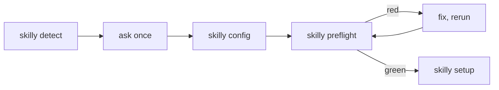

# Setup project

Ask the few questions Setup needs, then run the rest without the person. Every check and every write is an Engine script. Never edit `.skilly/config.json` by hand.

`skilly` below means the `npx github:timschoch/skilly` command that started Setup, with its `#<release>` when it had one.

## 1. Detect

Run `skilly detect`. It prints JSON:

| Key                     | Holds                                                                                |
| ----------------------- | ------------------------------------------------------------------------------------ |
| `repo`                  | `owner/name` of the GitHub origin, `null` without one                                |
| `tier`                  | the default: `tool`, or the tier `.skilly/config.json` already holds                 |
| `bundles`               | every Bundle of the Release: `ticked` from its detect hints or the config, `reasons` |
| `unmatchedDependencies` | packages no Bundle covers                                                            |

Read `README.md`, `package.json` and the top-level folders. Judge the stack yourself: a hint can miss.

## 2. Ask once

Ask all questions in one message, each with your pick. Accept "ok" as yes to every pick.

1. Bundles: the ticked ones with their reasons, plus any you add. Add a `project-<x>` Bundle when one fits the repo; it includes its `tech-*` Bundles. Add `marketing` only where the repo makes marketing content. Catalog: [docs/bundles.md](https://github.com/timschoch/skilly/blob/main/docs/bundles.md).
2. Tier, default `tool`:
   - `sandbox`: `ci.yml` only
   - `tool`: plus `ai-review.yml` and `dependabot.yml`
   - `product`: plus `nightly.yml` and `release.yml`
3. Only when `repo` is `null`: owner and name. Default: the folder name, private.

Name the notable `unmatchedDependencies`: frameworks and services no Bundle has skills for yet. Ask nothing about them.

Not asked: the App, the branch, hooks, release-please, the issue tracker, the docs layout. Setup and the Sync own them.

## 3. Write and check

1. `skilly config <tier> <bundle...>` writes `.skilly/config.json`.
2. `repo` was `null`: `gh repo create <owner>/<name> --private --source . --push`.
3. `skilly preflight` prints one line per check and exits 1 on a red one. Fix each red line, then rerun:
   - a missing secret: the person runs `gh secret set <name> --repo <owner>/<name>` in their own terminal, so the value never enters the chat. `claude setup-token` makes `CLAUDE_CODE_OAUTH_TOKEN`.
   - any other red line: do what its text says, or show it to the person when only they can.

## 4. Apply

Preflight green: run `skilly setup`. It opens the Setup PR and sets the repo settings. Show the PR URL and stop. The person merges it once `ci / verify` is green.

A second run starts again at [1. Detect](#1-detect): `detect` ticks what the config holds.
