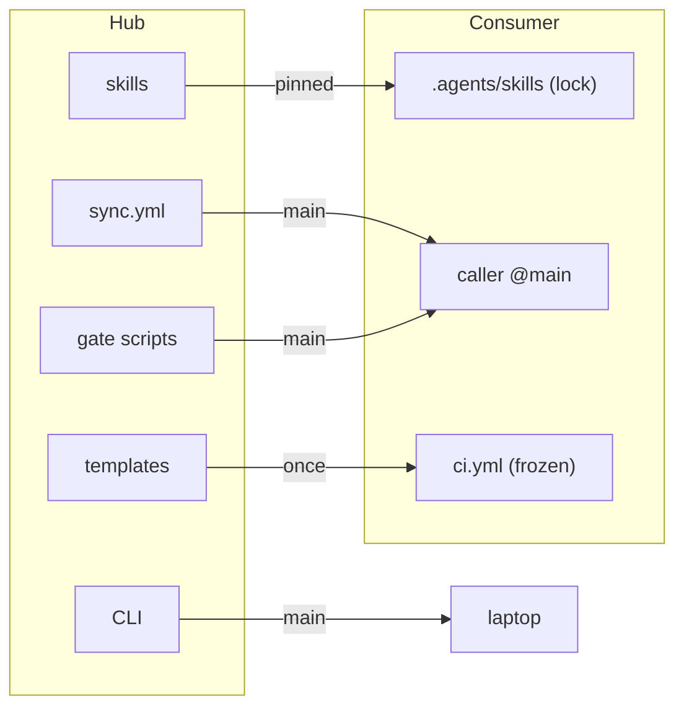
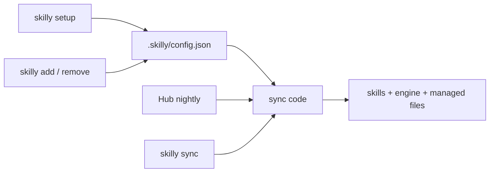
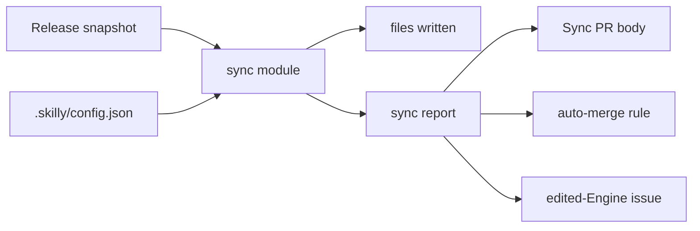

# ADR-0008: The Hub runs the sync, every Consumer runs one pinned Engine

Status: accepted, 2026-10-28. Supersedes [ADR-0005](0005-shared-ci-workflows.md). Changes decisions 2 and 5 of [ADR-0001](0001-dev-process-tiers.md). Setup in detail: [ADR-0009](0009-setup-decides-then-applies.md).

## Context

A Consumer gets skilly through five channels today. Each one runs a different version, so one PR can mix them.

| Channel                           | What it carries                                             | Version                       |
| --------------------------------- | ----------------------------------------------------------- | ----------------------------- |
| skills CLI into `.agents/skills/` | skills, and the verify code inside the `verify` skill       | `skills-lock.json`            |
| Shared workflows, caller `@main`  | [sync.yml](../../.github/workflows/sync.yml)                | Hub `main` at run time        |
| Hub checkout in CI                | [run-gate.mjs](../../scripts/run-gate.mjs), `skilly update` | Hub `main` at run time        |
| `npx github:timschoch/skilly`     | the CLI on a laptop                                         | Hub `main` at run time        |
| files copied by setup-repo        | `ci.yml`, `nightly.yml`, hooks, ruleset                     | the day of setup, then frozen |



What goes wrong:

- **Two PR checks.** `skilly / gate` runs bundle Rules from the Hub at `main`. `ci / verify` runs the same `naming` check from the copy in `.agents/skills/`. The two copies can disagree.
- **Tooling ships as a skill.** CI and hooks run code from `.agents/skills/verify/`. A skill is knowledge for an agent, not a program.
- **The sync does more than sync.** [sync.yml](../../.github/workflows/sync.yml) also runs the gate and merges.
- **Wiring in every repo.** 3 private Apps (one per account), 2 secrets and 1 sync caller per Consumer. A private App installs only on its own account.
- **Frozen copies drift.** No `ci.yml` ever received a fix after setup. glue edited its copy by hand.

Facts that shaped the decision, checked 2026-10-28:

- 15 Consumers. All are Node repos. All are owned by `timschoch` or `admin-laicadev`, and both accounts are on GitHub Pro, so private repos can require checks and use auto-merge. `swissdesign-md` is on Free and has no Consumer.
- The skilly users are one person and their agents. Nobody else installs from the Hub.
- The skills CLI installs from a tag: `timschoch/skilly#v1.4.0`. It clones with `--branch` and records `ref` in `skills-lock.json`.
- Hosted tools such as CodeRabbit, Renovate and pre-commit.ci use one App per account, installed on "all repositories". They run centrally and need at most one config file per repo.

## Decision

### Two channels, one version

1. Skilly reaches a Consumer through two channels. Both use the same Hub Release.

   | Channel   | Carries                                                                                     | Lands in                            | Written by                                    |
   | --------- | ------------------------------------------------------------------------------------------- | ----------------------------------- | --------------------------------------------- |
   | Knowledge | skills, Router rules                                                                        | `.agents/skills/`, `.claude/rules/` | skills CLI, from `timschoch/skilly#<release>` |
   | Engine    | all code that CI, hooks or the CLI run: sync, setup, verify, checks, managed workflow files | `.skilly/engine/`                   | skilly, copied from the Hub at `<release>`    |

   A skill may carry a small script that only an agent runs by hand. CI and hooks never run code from `.agents/skills/`.

2. A Hub Release is a git tag made by [release-please](https://github.com/googleapis/release-please). Merging the Release PR in the Hub ships a Release. `.skilly/config.json` records the Release a Consumer runs: `"hub": "v1.4.0"`.
3. The Hub repo is private. The Engine is committed in each Consumer, so no Consumer workflow and no hook needs to read the Hub.

### One check

4. A Consumer has one PR check: `ci / verify`, which runs `verify <stage>` from `.skilly/engine/`. A bundle Rule becomes a verify step that its Bundle adds. The `gate` job, [run-gate.mjs](../../scripts/run-gate.mjs) and `bundles/*/rules/*.sh` go away. Router rules in `bundles/*/rules/*.md` stay.
5. `ci.yml`, `nightly.yml`, `ai-review.yml`, `release.yml` and `dependabot.yml` are managed files. The Sync PR writes them from the Engine. Hook files such as `lefthook.yml` and `.claude/settings.json` also hold the Consumer's own entries, so the Sync PR writes only the skilly entries in them. There are no Shared workflows and no callers. A Consumer changes its checks in `.skilly/verify.json` and its tier in `.skilly/config.json`, never in a managed file.

### The sync

6. One scheduled workflow in the Hub syncs every Consumer each night. It runs the sync code of the newest Release, the same code a local `skilly add` runs.

   ```mermaid
   sequenceDiagram
     participant Hub as Hub nightly
     participant App as skilly App
     participant Consumer
     participant GitHub
     Hub->>App: list installations
     App-->>Hub: repos on allowed owners
     loop each repo with .skilly/config.json
       Hub->>Consumer: read config and engine hash
       alt engine edited by hand
         Hub->>Consumer: open or update issue, skip repo
       else newer Release or changed config
         Hub->>Consumer: push Sync PR (skills + engine + managed files)
         Hub->>GitHub: enable auto-merge unless major or removals
         GitHub->>Consumer: run ci / verify
         GitHub->>Consumer: merge when green
       end
     end
   ```

7. One Sync PR moves skills and Engine to the same Release. A Consumer never runs a mix of versions.
8. The Hub turns on GitHub auto-merge for a Sync PR. It does not when the Release is a new major version or the PR removes a skill. You merge those by hand. The Hub has no merge code: GitHub merges. The "no auto-merge" of ADR-0001 decision 6 is about `babysit-pr` and still holds.
9. The Hub itself runs `main`. It is the first Consumer of every change. A Release is the gate for all others. There is no extra canary.
10. The nightly compares `.skilly/engine/` with the hash recorded for its Release. A mismatch skips that Consumer and opens or updates one issue there. The other Consumers still sync. The Consumer's CI keeps running its edited Engine. That is the repo owner's choice.
11. A person starts the same Sync for one Consumer with `skilly sync` (decision 16). The Hub owner can also start the whole nightly by hand: `gh workflow run sync.yml --repo timschoch/skilly`.

    ```mermaid
    sequenceDiagram
      participant You
      participant Old as Engine (pinned Release)
      participant New as Engine (newest Release)
      participant GitHub
      You->>Old: skilly sync
      Old->>New: fetch newest Release
      Old->>New: run Sync and delivery
      New->>GitHub: push Sync PR branch, open PR, auto-merge rule
    ```

### One App

12. One skilly App, set to "any account can install". It is installed once per account with "all repositories". The Hub holds its ID and key. An owner allowlist in the Hub makes the sync ignore installs by anyone else.

    | Permission             | Why                                                             |
    | ---------------------- | --------------------------------------------------------------- |
    | `contents: write`      | push the Sync PR branch, read `.skilly/config.json`             |
    | `pull_requests: write` | open the Sync PR, turn on auto-merge                            |
    | `workflows: write`     | the Sync PR writes `.github/workflows/ci.yml` and `nightly.yml` |
    | `issues: write`        | report a Consumer whose Engine was edited (decision 10)         |
    | `administration: read` | report ruleset or auto-merge drift in the Sync PR body          |

    The App has no `administration: write`. Setup sets the ruleset and auto-merge once (decision 14).

### Setup and local commands

13. `skilly setup` stays a manual, local command: a person decides which repo gets skilly, its Bundles and its tier. It runs with the person's own `gh` login: `npx github:timschoch/skilly#<release> setup`. Running it again is safe. Each step checks first and skips what is already done. How setup asks and applies: [ADR-0009](0009-setup-decides-then-applies.md).
14. Setup writes `.skilly/config.json`, runs the first sync, sets the ruleset that requires `ci / verify` and drops `skilly / gate` from it, turns on `allow_auto_merge`, and opens the setup PR.
15. Setup checks that the repo's account can read `timschoch/skilly`. When it can't, setup prints the `gh api` call that invites that account as a read collaborator and continues. The nightly does not need this access. Local commands do, because the skills CLI clones the private Hub at the Release.
16. `skilly add` and `skilly remove` stay local, for "I want it now". Each one edits `.skilly/config.json` and runs the same sync code as the nightly, at the pinned Release, on the current branch. The Engine runs them: `node .skilly/engine/bin/skilly.js add <bundle>`.
    - `skilly sync` is the nightly for one Consumer, started now. It fetches the newest Release and runs that Release's Sync and delivery with the person's `gh` login. It opens or updates the same Sync PR, with the same auto-merge rule. The local Engine only starts it, so old Engine code never writes a newer Release.



### Code shape

The nightly and the local commands share one sync module, so both write the same files for the same Release.

17. One sync module. It takes a Consumer checkout, its `.skilly/config.json` and a Release snapshot. It writes the files and returns one sync report. The nightly, setup, `add`, `remove` and `sync` call it. Commit, push and PR stay outside it. It never prompts.
18. A Release snapshot is a folder with the files of one tag: Bundle configs, Router rules, the Engine, managed-file templates. The sync never reads the folder next to its own code, so the nightly can run `main` code and write an older Release. The nightly checks out the tag, a local run fetches it, a test uses a fixture folder.
19. The sync report is the one record of a sync. The Sync PR body, the auto-merge choice of decision 8 and the issue of decision 10 read it. Nothing parses commit subjects.
20. The Engine is one folder in the Hub, with plain imports and no copies. Its hash is the hash of that folder. Hub-only code stays outside it: the nightly loop, the App key, the installation list, the owner allowlist. The delivery for one Consumer is Engine code: Sync PR branch, PR, auto-merge rule.
21. All GitHub calls go through `gh`. The nightly gives it the App installation token in `GH_TOKEN`. Local commands use the person's login. The auto-merge rule of decision 8 is one function.
22. Two small mergers write the skilly entries in `lefthook.yml` and `.claude/settings.json`.



### Who owns what in a Consumer

| File                                                                   | Owner                  | A person edits it?            |
| ---------------------------------------------------------------------- | ---------------------- | ----------------------------- |
| `.skilly/config.json`                                                  | setup, `add`, `remove` | yes: Bundles, tier            |
| `.skilly/verify.json`, `.skilly/naming.json`                           | the Consumer           | yes                           |
| `.skilly/engine/`                                                      | the sync               | no, the nightly stops syncing |
| `.agents/skills/`, `.claude/rules/<bundle>-*.md`, `skills-lock.json`   | the sync               | no                            |
| `.claude/rules/*.local.md`                                             | the Consumer           | yes                           |
| `.github/workflows/ci.yml`, `nightly.yml`                              | the sync               | no                            |
| skilly entries in hook files (`lefthook.yml`, `.claude/settings.json`) | the sync               | no, the other entries yes     |
| ruleset, `allow_auto_merge`                                            | setup                  | no, the Sync PR reports drift |

## Consequences

- Per Consumer: no secret, no sync caller, no Shared workflow. Per account: one App install.
- Each Sync PR carries the Engine diff. `.gitattributes` marks `.skilly/engine/` as `linguist-generated`, so GitHub folds it in PR diffs.
- Shipping a change takes two merges in the Hub: the change, then the Release PR.
- The Hub's Actions logs name private repos. That is fine because the Hub is private.
- `admin-laicadev` and `swissdesign-md` become read collaborators on `timschoch/skilly`, once, for local commands in their repos.
- [add.js](../../lib/add.js) drops its limit of one private-source owner per Consumer. The private `admin-laicadev/laica-launcher` source is deprecated.
- Skills from third-party Sources keep today's update behavior. The Release fixes the version of the Hub's own skills and the Engine only.
- `laica-workflows` still uses `.skilly.json` and moves to `.skilly/config.json` with its first setup run.
- [check-upstream.yml](../../.github/workflows/check-upstream.yml) stays in the Hub and shares only the App with the sync. Today it is a Shared workflow called from `admin-laicadev` forks, and a private Hub can't share a workflow with another account. It is paused. How it runs after the Hub turns private needs a decision before it runs again.
- Lower CI minutes: each Consumer loses its scheduled sync and the gate job on every PR. Further cuts: [#201 Cut Actions minutes in consumer CI templates](https://github.com/timschoch/skilly/issues/201).

## Rejected

| Option                                                                       | Why not                                                                                                                    |
| ---------------------------------------------------------------------------- | -------------------------------------------------------------------------------------------------------------------------- |
| Pin the Hub by commit SHA                                                    | A SHA has no Release step, so nothing gates what ships. A tag is readable, carries a changelog, and marks a major version. |
| Caller workflows pinned to `@main` ([ADR-0005](0005-shared-ci-workflows.md)) | A bad Hub commit reaches every Consumer with no PR between. A private Hub can't share workflows across accounts.           |
| Public Hub, Engine fetched at run time                                       | Nothing outside the owner uses the Hub. Public Actions logs show private repo names to anyone logged in.                   |
| Engine as a private npm package                                              | A token in every Consumer's CI and in `.npmrc` on every machine. A public package publishes the code anyway.               |
| Sync caller in each Consumer                                                 | A workflow and 2 secrets per repo, the wiring this ADR removes.                                                            |
| A separate private runner repo for the sync                                  | Needed only while the Hub is public.                                                                                       |
| App with `administration: write`                                             | Strong permission for two settings that change once, at setup.                                                             |
| Hash check of the Engine in every CI run                                     | Costs minutes on every PR. The nightly check is enough, an edit is the owner's choice.                                     |
| Canary repos that sync a day earlier                                         | The Hub runs `main` and a Release is a deliberate step.                                                                    |
| A sync that sets up new repos                                                | Setup needs decisions a person makes: which repo, which Bundles, which tier.                                               |
| `skilly add` only edits config and waits for the nightly                     | "Add" means "I want it now", on the current branch.                                                                        |
| A GitHub interface with an App adapter and a `gh` adapter                    | Both end as a token for `gh`. A fake GitHub for tests needs many mocks for little gain.                                    |
| A general system for managed file fragments                                  | Only 2 files hold fragments.                                                                                               |
| Setup that diffs the repo against a full wanted state                        | A command you run once per repo needs only "check, then do" per step.                                                      |
| A manifest that lists the Engine files                                       | The Engine is one folder. The folder is the list.                                                                          |
