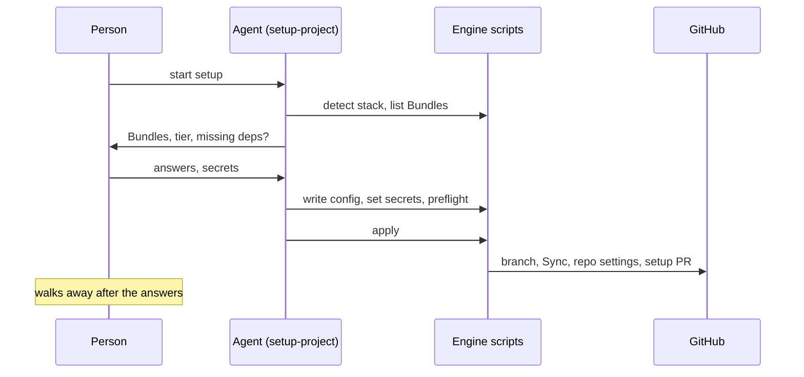

# ADR-0009: Setup decides in a chat, then code applies it

Status: accepted, 2026-10-28. Builds on decisions 13 to 16 of [ADR-0008](0008-hub-run-sync-and-pinned-engine.md).

## Context

Goal: answer a few questions, walk away, and come back to a Consumer where CI and local dev work.

Setup runs in 14 steps, over the CLI, a browser interview ([lib/interview/](../../lib/interview/)) and 4 setup skills that an agent reads. 10 steps stop for a person:

| Stop                                                     | Where                                                                                    |
| -------------------------------------------------------- | ---------------------------------------------------------------------------------------- |
| App create or reuse, install in the browser, wait 10 min | [lib/github-app.js](../../lib/github-app.js)                                             |
| "Use this branch?", throws without a terminal            | [lib/prepare-branch.js](../../lib/prepare-branch.js), [lib/run.js](../../lib/run.js)     |
| Which parts apply, which Bundles                         | [setup-project](../../bundles/setup-project/skills/setup-project/SKILL.md)               |
| Tier, `claude setup-token`                               | [setup-repo](../../bundles/setup-project/skills/setup-repo/SKILL.md)                     |
| Waits for a merge to check release-please                | [setup-release-please](../../bundles/setup-project/skills/setup-release-please/SKILL.md) |
| 3 to 5 confirms for issue tracker, labels, docs layout   | `setup-matt-pocock-skills`                                                               |
| Removal prompt                                           | [lib/update.js](../../lib/update.js)                                                     |
| "Fix only what the user picks"                           | `audit-skilly-workflow`, last step of `setup-project`                                    |

What goes wrong besides the stops:

- **Answers live in the chat.** The interview hands them to an agent as text. The setup skills ask some of them again.
- **Prose does a script's job.** `setup-repo` has the agent copy templates, merge YAML and JSON, and call `gh api` for the ruleset. All of it is deterministic.
- **One file, several writers.** `.claude/settings.json`: `setup-repo` and `gdd/scripts/setup.mjs`. `.husky/pre-commit`: `setup-pre-commit` and `setup-repo`. The tier: `lib/skilly-file.js` and a `node -e` line in `setup-repo`.
- **Tier logic in 5 places:** `ci.yml` bash, `verify.mjs`, `setup-repo`, the interview, [dev-process.md](../dev-process.md). They disagree on whether a sandbox repo requires `ci / verify`.

The LLM part of today's flow is worth keeping. It chose the stack well and suggested dependencies that no Bundle declared yet.

## Decision

### Two phases



1. **Decide.** An agent runs [setup-project](../../bundles/setup-project/skills/setup-project/SKILL.md) as a chat, in the style of the `grilling` skill. It reads the repo, proposes Bundles and a tier, and names missing dependencies. It calls a ready-made Engine script for every check and every write. It never writes `.skilly/config.json` by hand.
2. The decide phase ends with a preflight script: `gh` login, read access to the Hub, the skilly App on the account, a plan that allows rulesets, every secret the Bundles need. A red preflight stops before the apply phase.
3. **Apply.** `skilly setup` with a complete `.skilly/config.json` asks nothing and needs no terminal. It creates the branch `chore/skilly-setup`, runs the Sync, sets the repo settings and opens the setup PR. Running it again runs only this phase.
4. Questions left for the person:

   | Question                                     | Default                                         |
   | -------------------------------------------- | ----------------------------------------------- |
   | Bundles                                      | pre-ticked from the Bundles' detect hints       |
   | Tier                                         | `tool`                                          |
   | Owner and name, only when there is no remote | folder name, private                            |
   | Secrets the Bundles need                     | none, `CLAUDE_CODE_OAUTH_TOKEN` for tool and up |

   No longer asked: App setup (one App per account), the branch, hooks yes or no (every Consumer gets them), release-please (follows from the tier), issue tracker and docs layout (defaults: GitHub issues, default labels, single context).

### Bundles declare their facts as data

5. A Bundle's `config.json` declares, next to its skills:
   - its verify steps, each with stage, tier, the paths that trigger it and the toolchain it needs, such as Playwright browsers
   - its `fullSuiteTriggers`, for example `drizzle/`
   - detect hints that pre-tick it in the decide phase, such as a dependency in `package.json`
   - the secrets it needs
   - its hook entries for `lefthook.yml` and `.claude/settings.json`

   These replace `bundles/*/rules/*.sh` and the stack facts in setup skill prose.

6. Verify merges 3 layers: Engine defaults, then the steps of the Consumer's Bundles, then `.skilly/verify.json`. The Engine carries the Bundle configs of its Release, so a changed step reaches every Consumer with the next Sync PR.
7. CI runs one job. The `pr` stage skips a step when none of its paths changed. The managed `ci.yml` installs and caches only the toolchains of the resolved steps. The Engine picks the stage, not bash in `ci.yml`.

### Repo settings

8. One Engine module checks, then sets, each GitHub repo setting: the ruleset that requires `ci / verify` on every tier, sandbox included, `allow_auto_merge`, merge methods, delete branch on merge, the Actions PR permission, Dependabot alerts. Setup uses it to write. The Sync PR uses its read side to report drift.

### Managed files

9. The Sync writes `ci.yml`, `nightly.yml`, `ai-review.yml`, `release.yml` and `dependabot.yml` from Engine templates, by tier and package manager.
10. lefthook runs the git hooks in every Consumer. A Consumer on husky moves to lefthook with its first Sync PR.
11. `release.yml` runs release-please with the default `GITHUB_TOKEN`. A PR opened with that token starts no workflow, so `release.yml` then starts `ci.yml` on the release branch with `workflow_dispatch`. That run reports `ci / verify` on the PR's last commit. Verify this on one Consumer before the rollout.

    ```mermaid
    sequenceDiagram
      participant Main as push to main
      participant Rel as release.yml
      participant GitHub
      participant CI as ci.yml
      Main->>Rel: run release-please
      Rel->>GitHub: open or update release PR (default token)
      Rel->>CI: gh workflow run ci.yml --ref <release branch>
      CI->>GitHub: verify on the PR's commit
      GitHub->>GitHub: check green, PR can merge
    ```

### Setup skills

12. `setup-repo`, `setup-release-please` and `setup-pre-commit` go away. Their work moves into the Sync (decisions 9 and 10) and the repo settings module (decision 8). `setup-project` keeps only the decide phase.
13. Out of scope: the feel of the decide chat, new project bootstrap (starter app, Vercel, Neon), and judgment work after the setup PR (`CLAUDE.md` scaffold, README, audit). [#205 Redesign the guided setup chat and new project bootstrap](https://github.com/timschoch/skilly/issues/205).

## Consequences

- The App flow in [lib/github-app.js](../../lib/github-app.js), [lib/caller-workflow.js](../../lib/caller-workflow.js) and the add, read, remove round of each setup skill go away.
- The tier logic lives once, in the Engine.
- Tests run the apply phase on a fixture folder with a fake `gh` on the `PATH`.
- [ADR-0006](0006-oxlint-and-an-edit-hook.md) decisions 1, 2 and 6: the Sync writes the Oxlint and `.vscode/` files, not `setup-repo`.
- Open risk: decision 11 is untested. If GitHub does not count the `workflow_dispatch` run as the required check, release-please needs a new decision.

## Rejected

| Option                                                      | Why not                                                                               |
| ----------------------------------------------------------- | ------------------------------------------------------------------------------------- |
| A plain terminal prompt with 3 questions                    | Loses the agent's choices on stack and dependencies.                                  |
| The browser interview as the decide phase                   | It needs an MCP channel preview, and its answers stay in the chat.                    |
| Trim `setup-repo` and keep it                               | It writes files the Sync owns, so each file has two writers again.                    |
| The Hub runs release-please for each Consumer, with the App | The release PR updates once per night, and a merged release appears up to a day late. |
| An App secret per Consumer for release-please               | [ADR-0008](0008-hub-run-sync-and-pinned-engine.md) removes per-repo secrets.          |
| husky where a repo has it, lefthook elsewhere               | Two hook managers mean two templates and two fragment mergers.                        |
