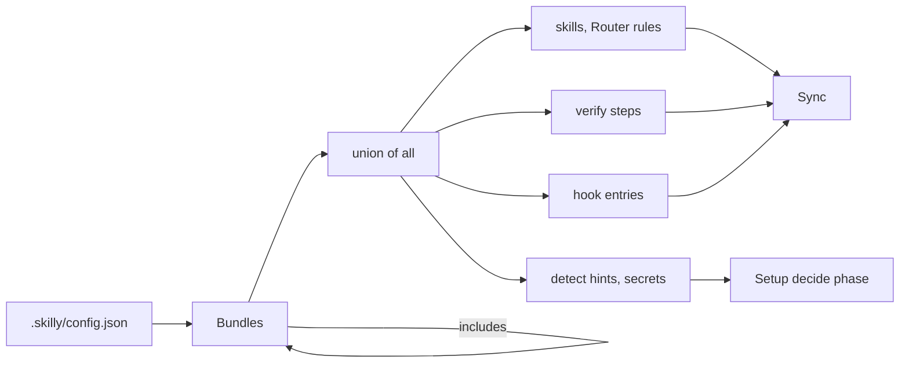

# Bundles

A Bundle is a named group of skills from one or more Sources. A Consumer adds Bundles, and skilly installs their skills. Example: Habits-Family/habits adds `project-habits` and gets the skills of its whole stack.

## Layout

Each Bundle is one directory under `bundles/`:

```
bundles/<name>/
  config.json   # required: { "includes": [...], "rules": [...], "verify": {...}, "sources": [{ "source": "owner/repo", "skills": [...] }] }
  skills/       # only skills maintained in this repo; external skills live in config.json only
  rules/        # <name>.md Router rule files, synced to Consumers
  docs/         # optional bundle docs
  README.md     # what the Bundle ships, and the skills left out and why
```

| Field      | Holds                                                                                                                                                                                             |
| ---------- | ------------------------------------------------------------------------------------------------------------------------------------------------------------------------------------------------- |
| `includes` | other Bundles, pulled in recursively. Adding `project-x` gives the union of `project-x` and all it includes. A cycle is an error.                                                                 |
| `rules`    | the Rules this Bundle declares. The `skilly / gate` check runs each `rules/<rule>.sh`, until every Consumer requires only `ci / verify`.                                                          |
| `verify`   | the Bundle's verify steps and full-suite triggers, see [Verify steps](#verify-steps). Each Rule of the Bundle is one of its steps.                                                                |
| `sources`  | one entry per Source repo, with the skills taken from it. Hub-maintained skills use the Source `timschoch/skilly`.                                                                                |
| `detect`   | the hints that pre-tick the Bundle in the decide phase of Setup: `dependencies` in `package.json` (a trailing `*` matches a prefix such as `@tanstack/*`), `files` in the repo root, or `always`. |
| `secrets`  | the repo secrets the Bundle needs. The preflight of Setup fails on each one the Consumer lacks.                                                                                                   |

`config.json` also declares the Bundle's hook entries ([ADR-0009](adr/0009-setup-decides-then-applies.md#bundles-declare-their-facts-as-data)).

### Verify steps

A Bundle adds checks to `verify` in every Consumer that has it, through an include too. Example: the `workflow` Bundle adds its Rules `conventional-commits` and `naming` ([config.json](../bundles/workflow/config.json)).

```json
{
  "verify": {
    "fullSuiteTriggers": ["drizzle/"],
    "steps": [{ "name": "naming", "stage": "push", "run": "node .agents/skills/naming/scripts/check.mjs" }]
  }
}
```

| Field                        | Holds                                                                                                                                    |
| ---------------------------- | ---------------------------------------------------------------------------------------------------------------------------------------- |
| `verify.fullSuiteTriggers`   | paths that make the changed-tests step run the full suite, appended to the default list                                                  |
| `verify.steps[].name`        | required. The key a Consumer uses in `.skilly/verify.json` to change or drop the step                                                    |
| `verify.steps[].stage`       | required. The stage that runs the step, for example `push`. A later stage that `extends` it runs it too                                  |
| `verify.steps[].run`         | required. The shell command, run from the repo root                                                                                      |
| `verify.steps[].tier`        | the lowest tier that runs the step: `sandbox`, `tool` or `product`                                                                       |
| `verify.steps[].target`      | a path the step needs. Missing, the step is skipped                                                                                      |
| `verify.steps[].dependency`  | a package the step needs in the root `package.json`, for example `"vitest"`. Not there, the step is skipped                              |
| `verify.steps[].paths`       | the paths that trigger the step. The `pr` stage skips the step when none of them changed                                                 |
| `verify.steps[].toolchain`   | what the step needs installed, for example `["playwright"]`. CI installs and caches only the toolchains of the resolved steps            |
| `verify.steps[].issueLabels` | the labels of the issue the nightly opens when the step goes red, for example `["nightly-tests", "critical"]`. One issue per first label |
| `verify.steps[].why`         | why the step exists. verify prints it when the step goes red                                                                             |

verify merges 3 layers: the default steps, the Bundle steps, then `.skilly/verify.json`. Other step fields, such as `replaces`: [verify skill](../bundles/workflow/skills/verify/SKILL.md).

The Engine carries the Bundle configs of its Release in `.skilly/engine/bundles/`. The Hub reads them from `bundles/`.



A Consumer has one PR check, `ci / verify`. It runs the verify steps of all its Bundles from the Engine in `.skilly/engine/`. `skilly setup` makes it a required check on `main`. Details: [dev-process.md](dev-process.md).

The Release in `.skilly/config.json` (`"hub": "v1.4.0"`) fixes the version of the Hub-maintained skills. Skills from third-party Sources are not pinned by the Release ([ADR-0008](adr/0008-hub-run-sync-and-pinned-engine.md)).

## How the Hub exports its own skills

A Consumer installs the Hub's skills from `timschoch/skilly#<release>` and sees only `bundles/*/skills/`. The Hub's `.agents/skills/` is its own install: the Hub is a Consumer of itself.

| Risk                                                                                                                                                                                                                                                                               | Guard                                                                                                                                                                                                                                                                                                                       |
| ---------------------------------------------------------------------------------------------------------------------------------------------------------------------------------------------------------------------------------------------------------------------------------- | --------------------------------------------------------------------------------------------------------------------------------------------------------------------------------------------------------------------------------------------------------------------------------------------------------------------------- |
| The skills CLI skips agent-dir skills named in this repo's `skills-lock.json`. It scans `bundles/` only when that pass finds nothing (`skills@1.5.23`, `dist/cli.mjs` `discoverSkills`). So one unlocked folder in `.agents/skills/` hides every Bundle skill from every Consumer. | [check-agents-lock.mjs](../scripts/check-agents-lock.mjs) checks the 1:1 match in CI. By hand: `npx skills@1.5.23 add timschoch/skilly -l` lists exactly the Bundle skills.                                                                                                                                                 |
| A Self-source would pin its own skills back into itself.                                                                                                                                                                                                                           | [lib/resolve.js](../lib/resolve.js) `resolveBundles` drops each skill of that Source the Consumer holds unpinned in `.agents/skills/`. [lib/self-source.js](../lib/self-source.js) reads the remote and the own skills. Habits-Family/habits gets the `tech-*` skills of `project-habits`, never its own `habits-*` skills. |

The Hub keeps its skills in `bundles/`, so it installs them like any Consumer. Self-source: [GLOSSARY.md](../GLOSSARY.md).

## Way of working

### workflow

Engineering and productivity skills, for any stack. Full list: [config.json](../bundles/workflow/config.json).

| Source                        | Skills                                                                                                                                  |
| ----------------------------- | --------------------------------------------------------------------------------------------------------------------------------------- |
| `timschoch/skilly`            | the Hub-maintained skills below                                                                                                         |
| `timschoch/mattpocock-skills` | `grilling`, `tdd`, `code-review` and more. `grill-me` and `grill-with-docs` are left out: they are 1-line slash aliases for `grilling`. |
| `cursor/plugins`              | `unslop`, `deslop`, the `principle-*` skills and more                                                                                   |
| `netresearch/context7-skill`  | `context7`: live library docs where no vendor docs skill exists                                                                         |
| `nutlope/hallmark`            | `hallmark` ([usehallmark.com](https://usehallmark.com)): new websites and pages that look designed, not generated                       |

| Hub-maintained skill                                     | Does                                                                                                                                                                                                                                                                               |
| -------------------------------------------------------- | ---------------------------------------------------------------------------------------------------------------------------------------------------------------------------------------------------------------------------------------------------------------------------------- |
| `orchestrate`, `step-by-step`, `cleanup-merged-branches` |                                                                                                                                                                                                                                                                                    |
| `audit-agent-history`                                    | mines the user's Claude Code and Codex session logs per model, counts failure modes, proposes up to three lines for `workflow-hazards.md`                                                                                                                                          |
| `audit-skilly-workflow`                                  | user-invoked. Finds where a Consumer's own instructions, the user's global instructions, hooks, lint and CI contradict or duplicate what skilly installed. A script gathers sources, gate values and config defects. The model judges meaning conflicts and writes an HTML report. |
| `skilly-cli`                                             | how a Consumer drives skilly's add, remove and sync. `setup-project` runs from the setup command and is never installed, so this is the standing reference.                                                                                                                        |
| `writing-rules`                                          | the writing rules for all repo artifacts, distilled from Habits-Family/habits v2-rebuild. They live in the Hub because they keep changing.                                                                                                                                         |
| `qa`                                                     | the Hub is its home: mattpocock/skills deprecated and deleted it. Its successors `triage` and `to-tickets` do not cover filing issues from a chat.                                                                                                                                 |

The Rules of `workflow` are its [verify steps](#verify-steps) in the `push` stage.

| Rule                   | Checks                                                                                                                                                                                                                                                                         |
| ---------------------- | ------------------------------------------------------------------------------------------------------------------------------------------------------------------------------------------------------------------------------------------------------------------------------ |
| `conventional-commits` | Conventional Commits headers                                                                                                                                                                                                                                                   |
| `naming`               | kebab-case files, no short words or noise words, no `enum`, no `I`/`T` type prefixes, verb synonyms, env var shape. The `naming` skill holds the guidelines. The Router rule `workflow-naming.md` points at it. `.skilly/naming.json` holds per-repo overrides and exceptions. |

### setup-project

One-time setup skills. A repo gets them at bootstrap, they are not carried everywhere. [config.json](../bundles/setup-project/config.json)

| Skill                      | Source                        | Does                                                                                                                                                                                 |
| -------------------------- | ----------------------------- | ------------------------------------------------------------------------------------------------------------------------------------------------------------------------------------ |
| `setup-project`            | Hub                           | the decide phase of Setup: an agent chat that calls Engine scripts to detect, write `.skilly/config.json` and run the preflight ([ADR-0009](adr/0009-setup-decides-then-applies.md)) |
| `setup-matt-pocock-skills` | `timschoch/mattpocock-skills` | repo scaffolding: issue tracker, triage labels, domain docs. Its skill-install half stays unused, see [Not bundled](#not-bundled).                                                   |

The Sync and the repo settings module do the rest: git hooks, managed workflows, release-please, merge settings.

### gdd

God-driven development, Hub-maintained `gdd`. [config.json](../bundles/gdd/config.json)

- A prayer session before planning big work. The heard guidance stays in `.temp/gdd.json` per branch.
- Silent drift checks, and a pre-PR check.
- The Router rule `gdd-checkpoints.md` sets when it runs.
- A PreToolUse hook holds `gh pr create` until the pre-PR check ran. The hook code ships in the Engine. The Sync writes its entry in `.claude/settings.json`.
- Config: `gdd.minutes`, `gdd.pr` in `.skilly/config.json`.

### npmjs

Publishing a package to the npm registry from GitHub Actions: `publish-npm-package` (yigitkonur/skills-by-yigitkonur, a broad personal catalog, pinned to this one skill). It is a release capability, not a stack, so it is no `tech-*` Bundle. It carries no release automation: the Sync writes `release.yml`. Proven shape (timschoch/animateTextWeight): release-please on `main`, plus a publish job gated on `release_created` that uses npm trusted publishing (OIDC, no `NPM_TOKEN`). Why it is its own Bundle: [README](../bundles/npmjs/README.md).

## Marketing

All marketing skills come from coreyhaines31/marketingskills, the canonical Source. The laica-launcher re-exports are dropped. Each Bundle includes the one above it.

| Bundle                                                          | Includes                             | Adds                                                                                      |
| --------------------------------------------------------------- | ------------------------------------ | ----------------------------------------------------------------------------------------- |
| [marketing](../bundles/marketing/config.json)                   | `tech-lemy`                          | minimal set: `ai-seo`, `cro`, `lead-magnets`, `seo-audit`                                 |
| [marketing-shop](../bundles/marketing-shop/README.md)           | `marketing`                          | for online shops, subscription shops above all: `churn-prevention`, `emails`, `referrals` |
| [marketing-extended](../bundles/marketing-extended/config.json) | `marketing-shop`, `tech-lemy-manage` | full suite: the remaining coreyhaines31/marketingskills                                   |

## Projects

A project Bundle holds the stack of one project.

| Bundle                                                  | Includes                                                                                                                                                               | Own skills                                                                             | Note                                                                                            |
| ------------------------------------------------------- | ---------------------------------------------------------------------------------------------------------------------------------------------------------------------- | -------------------------------------------------------------------------------------- | ----------------------------------------------------------------------------------------------- |
| [project-habits](../bundles/project-habits/config.json) | the habits stack (TanStack Start, Neon, Drizzle, PowerSync, Better Auth, PostHog, Vercel, Langfuse), plus `tech-react`, `tech-typescript`, `marketing` and `tech-lemy` | the `habits-*` skills of Habits-Family/habits                                          | habits itself is a Self-source and never gets its own `habits-*` skills                         |
| [project-laica](../bundles/project-laica/config.json)   | the tech Bundles of the colin and laica-workflows stacks, plus `tech-lemy`, `tech-nextjs`, `tech-typescript`                                                           | `laica-*` skills from the private `admin-laicadev/laica-launcher`, a deprecated Source | `tech-twenty` is not included. Only laica-stack uses Twenty, so it adds `tech-twenty` directly. |

## Tech

One Bundle per technology, from verified vendor skill repos. A `tech-*` Bundle holds 3 to 4 skills at most, because a Consumer loads many of them at once. Each README records the skills left out and why.

| Bundle                                                    | Source                                 | Note                                                                                                                                                                    |
| --------------------------------------------------------- | -------------------------------------- | ----------------------------------------------------------------------------------------------------------------------------------------------------------------------- |
| [tech-better-auth](../bundles/tech-better-auth/README.md) | better-auth/skills                     |                                                                                                                                                                         |
| [tech-drizzle](../bundles/tech-drizzle/README.md)         | Hub                                    | no vendor skill repo exists                                                                                                                                             |
| [tech-langfuse](../bundles/tech-langfuse/README.md)       | langfuse/skills                        |                                                                                                                                                                         |
| [tech-lemy](../bundles/tech-lemy/README.md)               | timschoch/lemy                         | `lemy-write` plus the Router rule `tech-lemy-write.md`: all copy goes through `lemy-write`                                                                              |
| [tech-lemy-manage](../bundles/tech-lemy-manage/README.md) | timschoch/lemy                         | includes `tech-lemy`, adds `lemy-brand`                                                                                                                                 |
| [tech-n8n](../bundles/tech-n8n/README.md)                 | n8n-io/skills, czlonkowski/n8n-skills  | 15 skills, a recorded exception to the cap                                                                                                                              |
| [tech-neon](../bundles/tech-neon/README.md)               | neondatabase/agent-skills, Hub         | includes `tech-postgres`                                                                                                                                                |
| [tech-nextjs](../bundles/tech-nextjs/README.md)           | vercel/next.js `skills/`               | version-matched official skills, includes `tech-react`. The old vercel-labs/next-skills repo is a dead pointer.                                                         |
| [tech-payload](../bundles/tech-payload/README.md)         | payloadcms/skills, Hub                 |                                                                                                                                                                         |
| [tech-postgres](../bundles/tech-postgres/README.md)       | neondatabase/postgres-skills           |                                                                                                                                                                         |
| [tech-posthog](../bundles/tech-posthog/README.md)         | PostHog/skills, Hub                    |                                                                                                                                                                         |
| [tech-powersync](../bundles/tech-powersync/README.md)     | powersync-ja/agent-skills, Hub         |                                                                                                                                                                         |
| [tech-react](../bundles/tech-react/README.md)             | vercel-labs/agent-skills               | the React skills of that repo                                                                                                                                           |
| [tech-resend](../bundles/tech-resend/README.md)           | resend/resend-skills, Hub              | Hub `setup-resend`: pre-launch mail on the shared domain `apps.timschoch.com`, see below                                                                                |
| [tech-shadcn](../bundles/tech-shadcn/README.md)           | shadcn-ui/ui                           | the official `shadcn` skill                                                                                                                                             |
| [tech-shopify](../bundles/tech-shopify/README.md)         | Shopify/Shopify-AI-Toolkit             | one official `shopify` skill for every Shopify surface, references load per topic. `ucp` is left out: it is buyer-side.                                                 |
| [tech-tanstack](../bundles/tech-tanstack/README.md)       | TanStack/router                        | six skills, above the cap, because TanStack Start is the main dependency of the `project-habits` stack                                                                  |
| [tech-trigger-dev](../bundles/tech-trigger-dev/README.md) | triggerdotdev/skills, Hub              |                                                                                                                                                                         |
| [tech-twenty](../bundles/tech-twenty/README.md)           | twentyhq/twenty, `agent-skills` branch | building Twenty SDK apps, reading workspace data over MCP                                                                                                               |
| [tech-typescript](../bundles/tech-typescript/README.md)   | cursor/plugins, wshobson/agents        | `typescript-best-practices` for discipline, `typescript-advanced-types` for type-system mechanics. wshobson/agents is a big marketplace repo, pinned to this one skill. |
| [tech-vercel](../bundles/tech-vercel/README.md)           | Hub                                    | `vercel-cli` only                                                                                                                                                       |

### Source quirks

| Bundle          | Quirk                                                                                                                                    | So                                                                                                              |
| --------------- | ---------------------------------------------------------------------------------------------------------------------------------------- | --------------------------------------------------------------------------------------------------------------- |
| `tech-tanstack` | the skills live under `packages/<pkg>/skills/`, and the skills CLI discovers one level below the URL                                     | one tree URL per skill                                                                                          |
| `tech-twenty`   | on `main` all skills share one `references/` tree, so they install broken. A bare `twentyhq/twenty` finds only `qa-scout`.               | take the `agent-skills` publishing branch, where each skill carries its own `references/`                       |
| `tech-posthog`  | the skills sit too deep for the CLI to find from the repo root                                                                           | a tree URL into `skills/posthog/all/`                                                                           |
| `workflow`      | `cursor/plugins` has a `.claude-plugin/marketplace.json` that lists only `origin-apps` and `pstack`, so the CLI hides `cursor-team-kit/` | a tree URL into `cursor-team-kit/` for `deslop`, `make-pr-easy-to-review`, `thermo-nuclear-code-quality-review` |

### setup-resend

Our conventions for pre-launch mail on the shared domain `apps.timschoch.com`: address naming, one API key per repo, `resend.json`, and the usual `mail.ts` and `inbound.ts` as templates.

### CLI reminder skills

Small Hub-maintained skills that remind an agent to use the product CLI: `neon-cli`, `trigger-cli`, `vercel-cli`, `payload-cli`, `posthog-cli`, `powersync-cli`, `drizzle-cli`. Each lives in its tech Bundle's `skills/`. Each description covers only what the CLI covers.

| CLI skill                                                                | Docs come from                           |
| ------------------------------------------------------------------------ | ---------------------------------------- |
| `neon-cli`, `trigger-cli`, `payload-cli`, `posthog-cli`, `powersync-cli` | the vendor skills in the same Bundle     |
| `vercel-cli`                                                             | none: `tech-vercel` has no vendor skill  |
| `drizzle-cli`                                                            | `context7`: no drizzle docs skill exists |

- `neonctl skills` and `vercel skills` install skills, they are no docs commands. The CLI skills do not reference them, because skilly owns skill installs.
- drizzle-team ships skills inside the `drizzle-kit` npm package, on the 1.0.0-rc line only. Revisit at 1.0 stable.

## Other

| Bundle                                          | Holds                                                                                                                                                                                |
| ----------------------------------------------- | ------------------------------------------------------------------------------------------------------------------------------------------------------------------------------------ |
| [pitchdeck](../bundles/pitchdeck/config.json)   | deck review and pitch skills: `pitch-deck-reviewer` (onewave-ai/claude-skills), `alex-hormozi-pitch` (microck/ordinary-claude-skills), `yc-pitch-deck` (guia-matthieu/clawfu-skills) |
| [test-bundle](../bundles/test-bundle/README.md) | internal: two one-line mock skills to pilot-test skilly's add, remove and sync. Never propose it to a Consumer.                                                                      |

## Not bundled

| Skill                                                                                                                                  | Why                                                                                                              |
| -------------------------------------------------------------------------------------------------------------------------------------- | ---------------------------------------------------------------------------------------------------------------- |
| skill installers: `neonctl skills`, `vercel skills`, the install half of `setup-matt-pocock-skills`                                    | skilly owns skill installs. `setup-matt-pocock-skills` itself ships in `setup-project` for its repo scaffolding. |
| `lemy-setup`                                                                                                                           | one-time: it removes itself after the run. See [tech-lemy](../bundles/tech-lemy/README.md).                      |
| `lemy-admin`                                                                                                                           | internal to `timschoch/lemy`                                                                                     |
| meco only: `writing-beats`, `writing-fragments`, `writing-shape`, `scaffold-exercises`, `migrate-to-shoehorn`, `setup-ts-deep-modules` | meco pins them itself                                                                                            |
| colin one-offs: `impeccable`, `frontend-slides`, `frontend-design`, `security-best-practices`, `seo-geo`                               | colin pins its own                                                                                               |
| `obsidian-vault`                                                                                                                       | lerni-berni only                                                                                                 |
