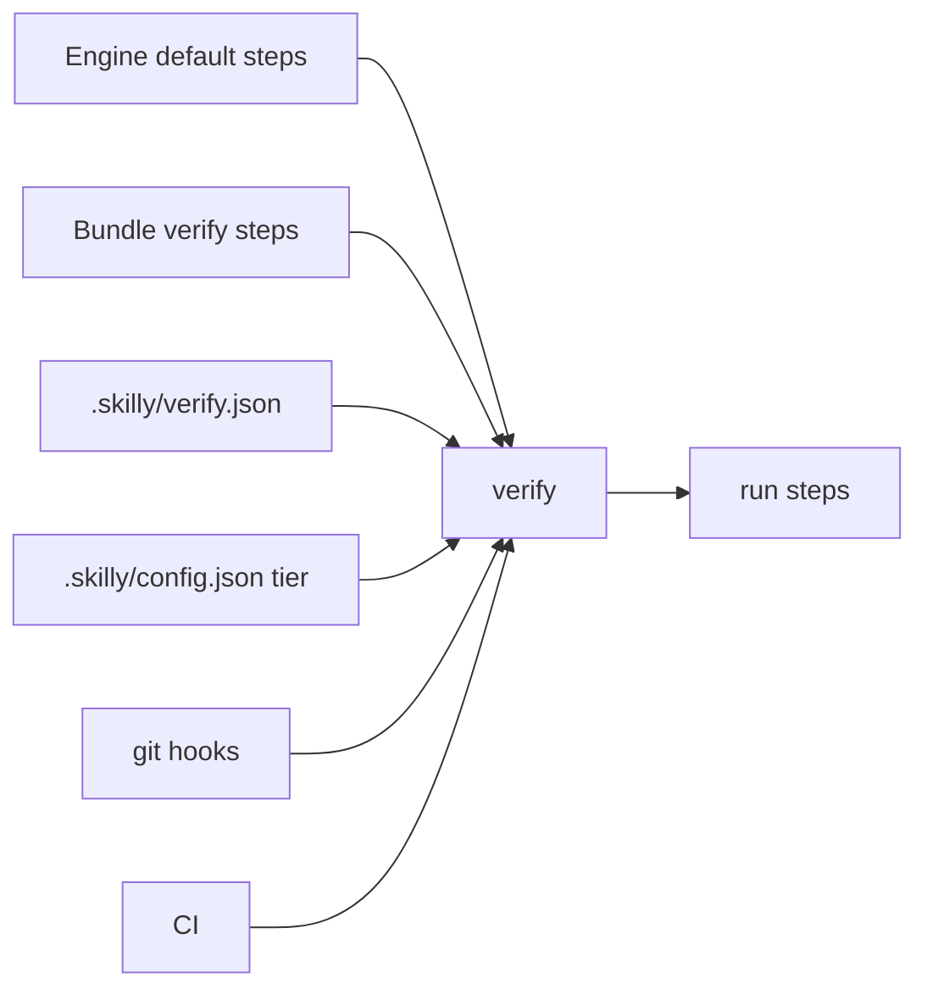
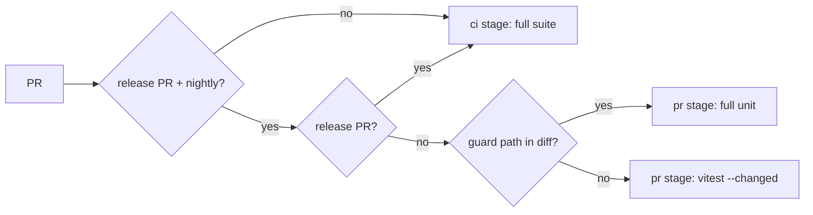
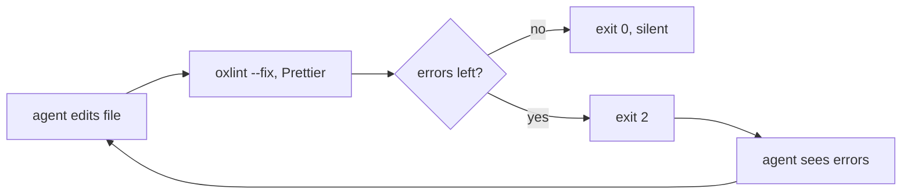
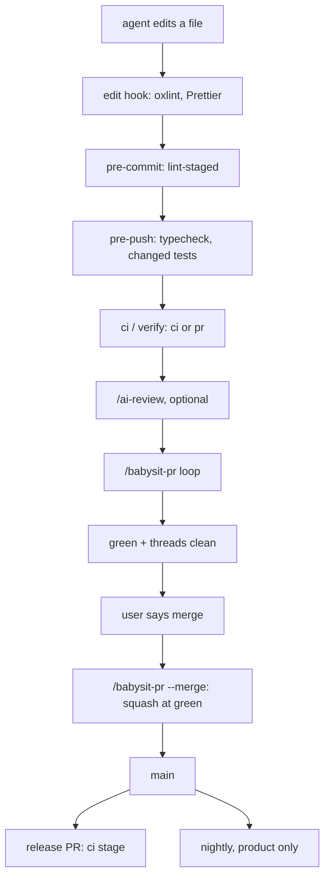
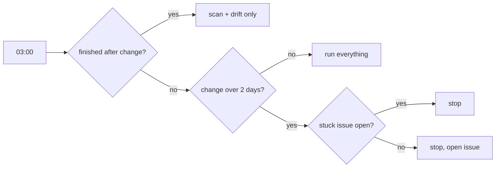
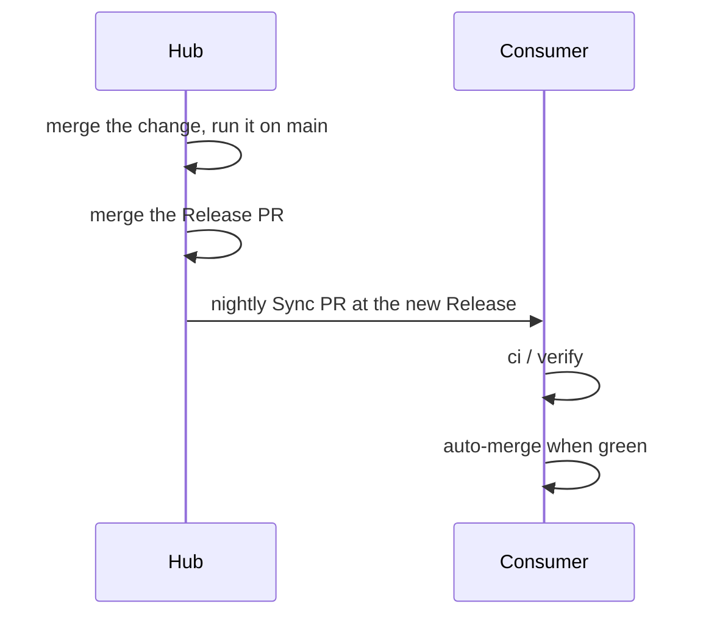
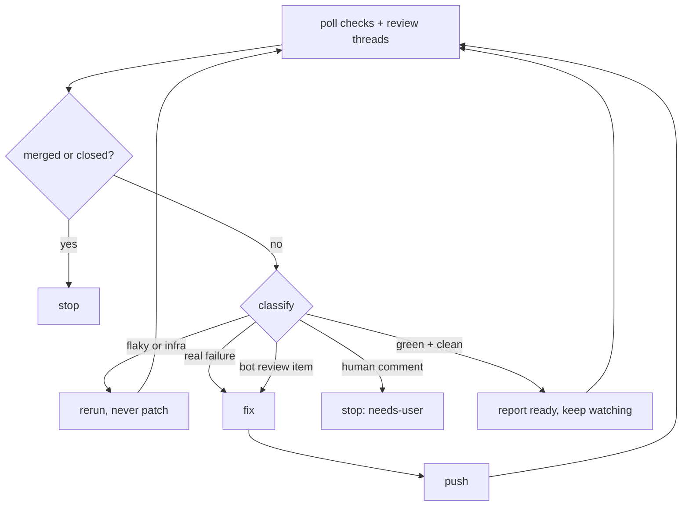

# Dev process

Every Consumer runs its checks through one command: `verify <stage>`. Git hooks and CI both call it, from the Engine in `.skilly/engine/`. A tier in `.skilly/config.json` decides how many checks run. Example: glue is a product repo, so each night it runs full e2e and Stryker. A sandbox repo has no nightly.

- verify merges 3 layers in this order: the [default steps](../engine/verify/verify.json), the steps of the Consumer's Bundles, then `.skilly/verify.json`. A later layer changes or drops a step by its `name`.
- Each Bundle declares its verify steps in its `config.json`, for example the `naming` Rule of `workflow` ([bundles.md](bundles.md#verify-steps), [ADR-0009](adr/0009-setup-decides-then-applies.md#bundles-declare-their-facts-as-data)).
- verify skips a stage above the repo's tier and a step whose `target` file does not exist.
- CI and hooks never run code from `.agents/skills/`.

## Rules

| Rule                                                                                                                                                                       | Why                                                                                                                                     |
| -------------------------------------------------------------------------------------------------------------------------------------------------------------------------- | --------------------------------------------------------------------------------------------------------------------------------------- |
| Keep every LLM out of every git hook.                                                                                                                                      | Hooks stay deterministic and fast. An LLM review in pre-push cost up to 5 minutes per push ([ADR-0001](adr/0001-dev-process-tiers.md)). |
| Add a check as one step, never as a line in a hook or a workflow. One Consumer: `.skilly/verify.json`. All Consumers: [the verify defaults](../engine/verify/verify.json). | Hooks and CI read the same step, so a check runs the same everywhere.                                                                   |
| Hold sandbox to the same code quality as product.                                                                                                                          | The tier sets the size of the net, not the standard.                                                                                    |
| Run review on request: `/code-review` locally, `/ai-review` as a PR comment on tool and product repos.                                                                     | An LLM review costs minutes per run.                                                                                                    |
| Leave the merge to the user. Stop at green and report, per [workflow-done](../.claude/rules/workflow-done.md). When the user says merge, `/babysit-pr` merges at green.    | Pushed means the user signed off.                                                                                                       |
| Give the product tier its nightly and its security scan. Never gate a merge on either.                                                                                     | Both run on `main` after the merge.                                                                                                     |

## Tiers

The tiers nest: everything `sandbox` runs, `tool` runs too, and everything `tool` runs, `product` runs too.

| Stage                                                                        | sandbox | tool | product |
| ---------------------------------------------------------------------------- | :-----: | :--: | :-----: |
| IDE: Oxlint errors and fix on save, from `.vscode/`                          |   yes   | yes  |   yes   |
| agent edit hook: `oxlint --fix` + Prettier on the edited file                |   yes   | yes  |   yes   |
| pre-commit: `lint-staged`, `oxlint --fix` + Prettier on staged files         |   yes   | yes  |   yes   |
| pre-push: typecheck + the tests the diff reaches                             |   yes   | yes  |   yes   |
| `ci / verify`, the only PR check: lint, typecheck, unit, build, Bundle steps |   yes   | yes  |   yes   |
| `ci / verify` required on `main`, set by `skilly setup`                      |   yes   | yes  |   yes   |
| local `/code-review` on request; `/babysit-pr`                               |   yes   | yes  |   yes   |
| `/ai-review` PR comment runs the `code-review` skill, posts inline comments  |   no    | yes  |   yes   |
| Dependabot alerts + `npm audit --audit-level=high` in `ci / verify`          |   no    | yes  |   yes   |
| `ci / verify`: e2e smoke (on the `pr` stage: release PR only)                |   no    |  no  |   yes   |
| nightly: full unit, full e2e, Stryker, dependency drift, security scan       |   no    |  no  |   yes   |
| `/security-review` locally before release                                    |   no    |  no  |   yes   |

### Which stage a PR runs

| Repo                                     | PR         | Stage | Unit tests                 |  e2e smoke   |
| ---------------------------------------- | ---------- | ----- | -------------------------- | :----------: |
| product, with a release PR and a nightly | normal PR  | `pr`  | the tests the diff reaches |      no      |
| product, with a release PR and a nightly | release PR | `ci`  | full suite                 |     yes      |
| every other repo                         | every PR   | `ci`  | full suite                 | product only |

Why: in one product Consumer the full unit suite took up to 440 s on each PR run. The release PR and the nightly run the full suites, so a normal PR can skip them ([ADR-0003](adr/0003-pr-stage-defers-full-suites.md)). Stage list: [verify](../bundles/workflow/skills/verify/SKILL.md#stages).

The tests the diff reaches come from `vitest --changed`. Vitest follows imports only, so a guard runs the full suite when the diff holds a lockfile, `package.json`, a test config or a `fullSuiteTriggers` path.

### Lint

A new Consumer lints with Oxlint. An existing one keeps its linter until it migrates. The agent edit hook exits 2 when errors are left, so the agent sees them at the edit, not one CI round later. Why Oxlint over ESLint: [ADR-0006](adr/0006-oxlint-and-an-edit-hook.md).

## Life of a change

## The nightly

The nightly runs its tests only when `main` changed since the last nightly that finished, green or red. Why: the same code gives the same result, so a night with no change buys no new information ([ADR-0004](adr/0004-nightly-runs-only-on-change.md)). The security scan and deps drift run every night, because they find new problems without a code change.

- A plan script in verify makes this choice, not the workflow. It returns the `nightly` stage, the `nightly-scan` stage or stop.
- A cancelled or timed-out night is not finished.
- A manual run (`workflow_dispatch`) runs everything.
- verify runs every step, also after a red one, so each check gets its own result.
- `timeout-minutes: 30`. The worst case per change on `main` is 2 nights of 30 minutes.

Each check has one open issue at most. A later night with a different list of problems adds a comment.

| Check                  | Runs                                      | Red opens issue with labels    |
| ---------------------- | ----------------------------------------- | ------------------------------ |
| full unit, full e2e    | after a change                            | `nightly-tests`, `critical`    |
| Stryker, changed files | after a change                            | `nightly-stryker`              |
| security scan          | every night                               | `nightly-security`, `critical` |
| deps drift             | every night                               | none, Dependabot opens the PRs |
| stuck guard            | change over 2 days old, no finished night | `nightly-stuck`                |

Why Stryker: coverage counts a line as tested when a test runs it, even with no assertion on its result. Stryker is too slow for a PR, so it runs at night on the changed files only ([ADR-0007](adr/0007-stryker-in-the-nightly.md)).

## How a change reaches a Consumer

The Hub ships a change as a Release, a git tag that release-please makes. One Sync PR moves a Consumer's skills, Engine and Managed files to that Release. So a Consumer never runs a mix of versions ([ADR-0008](adr/0008-hub-run-sync-and-pinned-engine.md)).

| Part                                            | Lands in                                | Why it comes this way                                                                            |
| ----------------------------------------------- | --------------------------------------- | ------------------------------------------------------------------------------------------------ |
| skills, Router rules                            | `.agents/skills/`, `.claude/rules/`     | knowledge for the agent, installed by the skills CLI from `timschoch/skilly#<release>`           |
| Engine: verify, the checks, sync and setup code | `.skilly/engine/`                       | committed in the Consumer, so CI and hooks never read the private Hub                            |
| Managed files: workflows, `dependabot.yml`      | `.github/`                              | written from the Engine, so a fix reaches every Consumer with the next Sync PR                   |
| skilly entries in hook files                    | `lefthook.yml`, `.claude/settings.json` | the Consumer keeps its own entries in these files, so the Sync PR writes only the skilly entries |

- The Hub runs `main` and is the first Consumer of each change. A Release is the gate for all others.
- `.skilly/config.json` records the Release a Consumer runs: `"hub": "v1.4.0"`.
- A new major Release, or a Sync PR that removes a skill, waits for a manual merge.
- A hand edit in `.skilly/engine/` stops the nightly sync for that Consumer. The nightly opens one issue there.
- A Consumer changes its checks in `.skilly/verify.json` and its tier in `.skilly/config.json`, never in a Managed file.
- `skilly add` and `skilly remove` run the same sync code on the current branch, for "I want it now".
- `skilly sync` runs the nightly for one Consumer now: the same Sync PR to the newest Release.
- Who owns each file: [ADR-0008](adr/0008-hub-run-sync-and-pinned-engine.md#who-owns-what-in-a-consumer).

## The babysit loop

- Green plus clean is a milestone, not an end state. New review items can still arrive.
- The loop ends only at merged, closed or needs-user.
- The CI budget is 3 attempts per PR, fix pushes and reruns together. The third red ends at needs-user.
- Merge mode (`--merge`, or `m` in `git-shortcuts`) merges at green.

Details: [babysit-pr](../bundles/workflow/skills/babysit-pr/SKILL.md).

## `.skilly/`

| File          | Holds                                                                            |
| ------------- | -------------------------------------------------------------------------------- |
| `config.json` | tier, the Consumer's Bundles, the Release it runs (`hub`)                        |
| `engine/`     | the Engine. The Sync PR writes it, never edit it by hand.                        |
| `verify.json` | changes to the default and Bundle verify steps, matched by step `name`; optional |
| `naming.json` | overrides and exceptions for the `naming` Rule                                   |

## Terms

[GLOSSARY.md](../GLOSSARY.md) defines `Consumer`, `Hub`, `Bundle`, `Rule`, `Skill`, `Sync PR`, `Release`, `Engine` and `Managed file`. Bundle layout: [bundles.md](bundles.md). The research behind these decisions lives outside the repo.
