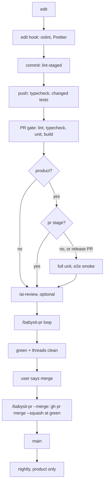
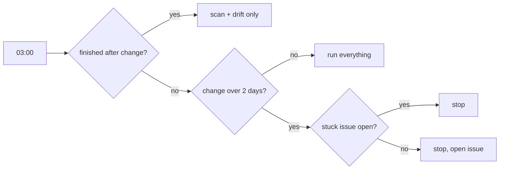
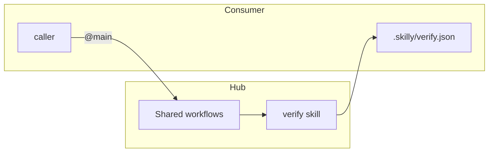
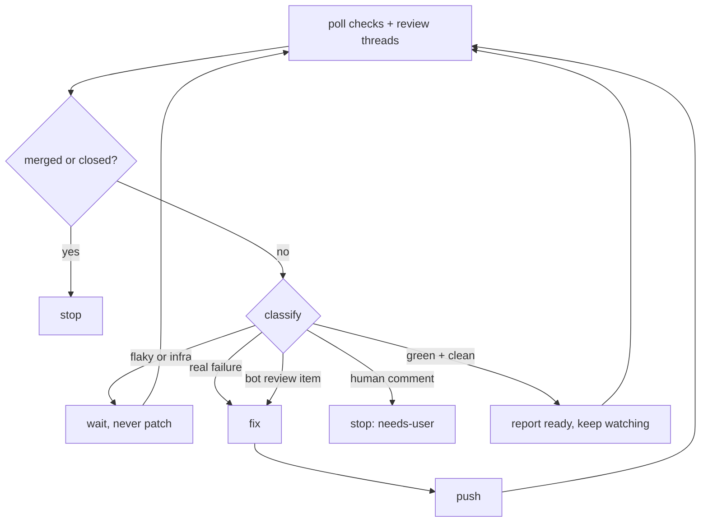

# Dev process

One verify config, three tiers, nested. Every Consumer declares a tier in `.skilly/config.json`. Its checks are the verify skill's default steps, with the Consumer's changes from `.skilly/verify.json` merged on top. Hooks and CI call `verify <stage>`, which reads the tier, skips stages above it, and skips steps whose target does not exist. `sandbox` is a subset of `tool`, `tool` a subset of `product`, so a product repo runs everything a sandbox repo runs.

## Tiers

| Stage                                                                       | sandbox | tool | product |
| --------------------------------------------------------------------------- | :-----: | :--: | :-----: |
| IDE: Oxlint errors and fix on save, from `.vscode/`                         |   yes   | yes  |   yes   |
| agent edit hook: `oxlint --fix` + Prettier on the edited file               |   yes   | yes  |   yes   |
| pre-commit: `lint-staged`, `oxlint --fix` + Prettier on staged files        |   yes   | yes  |   yes   |
| pre-push: typecheck + the tests the diff reaches                            |   yes   | yes  |   yes   |
| PR gate: lint + typecheck + unit + build, one job                           |   yes   | yes  |   yes   |
| local `/code-review` on request; `/babysit-pr`                              |   yes   | yes  |   yes   |
| `/ai-review` PR comment runs the `code-review` skill, posts inline comments |   no    | yes  |   yes   |
| required checks on `main` (GitHub Pro or Team)                              |   no    | yes  |   yes   |
| Dependabot alerts + `npm audit --audit-level=high` in the PR gate           |   no    | yes  |   yes   |
| PR gate: e2e smoke (on the `pr` stage: release PR only)                     |   no    |  no  |   yes   |
| nightly: full unit, full e2e, Stryker, dependency drift, security scan      |   no    |  no  |   yes   |
| `/security-review` locally before release                                   |   no    |  no  |   yes   |

A product repo with a release PR and a nightly runs the `pr` stage on its PRs: the tests the diff reaches, no full unit suite, no e2e smoke. The release PR runs `ci` with both, the nightly runs the full suites. Stages and the changed-tests guard: [verify](../bundles/workflow/skills/verify/SKILL.md#stages). Decision: [ADR-0003](adr/0003-pr-stage-defers-full-suites.md).

The tests the diff reaches come from `vitest --changed`, plus a guard: a diff with a lockfile, `package.json`, a test config or a `fullSuiteTriggers` path runs the full suite.

A new Consumer lints with Oxlint, an existing one keeps its linter until it migrates. The agent edit hook exits 2 when errors are left, so the agent sees them. Decision: [ADR-0006](adr/0006-oxlint-and-an-edit-hook.md).

## Life of a change

## The nightly

The nightly runs its tests only when `main` changed since the last nightly that finished, green or red. The security scan and deps drift run every night: they find new problems without a code change.

- A cancelled or timed-out night is not finished.
- A manual run (`workflow_dispatch`) runs everything.
- `timeout-minutes: 30`. The worst case per change on `main` is 2 nights of 30 minutes.

One open issue per check. A later night with a different list of problems adds a comment.

| Check                | Runs                                      | Red opens issue with labels    |
| -------------------- | ----------------------------------------- | ------------------------------ |
| full unit, full e2e  | after a change                            | `nightly-tests`, `critical`    |
| Stryker, incremental | after a change                            | `nightly-stryker`              |
| security scan        | every night                               | `nightly-security`, `critical` |
| deps drift           | every night                               | none, Dependabot opens the PRs |
| stuck guard          | change over 2 days old, no finished night | `nightly-stuck`                |

Decisions: [ADR-0004](adr/0004-nightly-runs-only-on-change.md), [ADR-0007](adr/0007-stryker-in-the-nightly.md).

## How a change reaches a Consumer

A change in the Hub reaches a Consumer by one of three paths. Which one depends on who owns the file.

| Part                                                   | Owner                    | Path                                   |
| ------------------------------------------------------ | ------------------------ | -------------------------------------- |
| `verify` skill: default steps, `verify.mjs`, the guard | Hub                      | Sync PR, merges itself when green      |
| `ci.yml`, `nightly.yml`                                | Hub, as Shared workflows | next run: the caller points at `@main` |
| callers, lint config, lint-staged, `.vscode/`, hooks   | Consumer                 | one setup-repo run in the Consumer     |

A Consumer sets its CI in `.skilly/verify.json`, `.skilly/config.json` and its caller: triggers, permissions, Node version, package manager, secrets. Full table: [ADR-0005](adr/0005-shared-ci-workflows.md).

## The babysit loop

Green plus clean is a milestone, not a terminal state: new review items still land. Terminal states are merged, closed, needs-user. The CI budget is 3 attempts per PR, fix pushes and reruns together; the third red ends at needs-user. Merge mode (`--merge`, or `m` in `git-shortcuts`) merges at green.

## `.skilly/`

| File          | Holds                                                                 |
| ------------- | --------------------------------------------------------------------- |
| `config.json` | tier and the Consumer's Bundles                                       |
| `verify.json` | changes to the default verify steps, matched by step `name`; optional |
| `naming.json` | overrides and exceptions for the `naming` Rule                        |

## Rules

- Keep every LLM out of every git hook. Hooks are deterministic and fast.
- Add a check as one step, never as a line in a hook or a workflow: in `.skilly/verify.json` for one Consumer, in [the verify defaults](../bundles/workflow/skills/verify/references/verify.json) for all.
- Hold sandbox to the same code quality as product. The tier sets the size of the net, not the standard.
- Run review on request: `/code-review` locally, `/ai-review` as a PR comment on tool and product repos.
- Leave the merge to the user. Stop at green and report, per [workflow-done](../.claude/rules/workflow-done.md). Merge only when the user says so; babysit-pr then merges at green.
- Give the product tier its nightly and its security scan. Never gate a merge on either.

## Terms

`Consumer`, `Hub`, `Bundle`, `Rule`, `Skill` and `PR gate` are defined in [GLOSSARY.md](../GLOSSARY.md). Bundle layout is in [bundles.md](bundles.md).

The research behind these decisions lives outside the repo.
